# Flowlet

> **Set your on-chain automation once. Reactive makes it happen when the event occurs — even when you're offline.**

**Your wallet. Your rules. Automatic execution.** Set an on-chain condition once (a due time, an incoming deposit, an allowance change). A **reactive contract on Reactive Network (Lasna testnet)** watches for the event and triggers your rule through a callback, without a bot of yours running 24/7. Your tokens stay in your wallet; the vault can only pull what an active rule allows, within the allowance you set.

Built for the [Reactive Omni Buildathon](https://dorahacks.io/hackathon/reactive-omni-buildathon), track **Set It and Forget It**.

**Live app:** [https://flowlet-kappa.vercel.app](https://flowlet-kappa.vercel.app) · no sign-up, no email, no password: a wallet, or no wallet at all for the replay.

| Welcome | Home (live testnet) | Desktop |
|---|---|---|
| 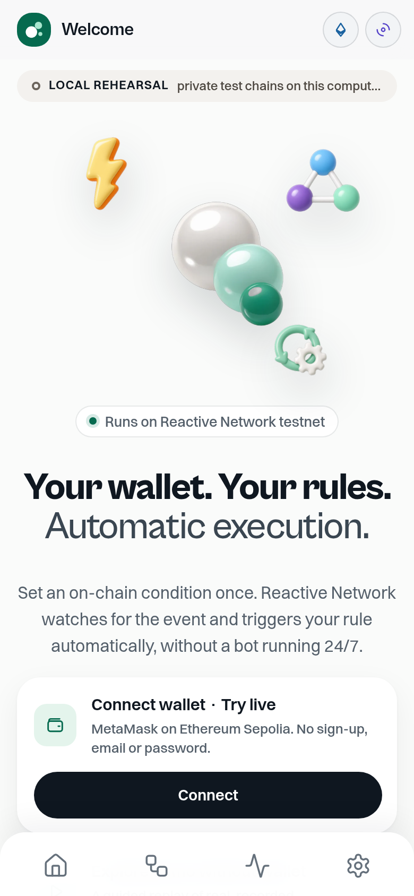 | 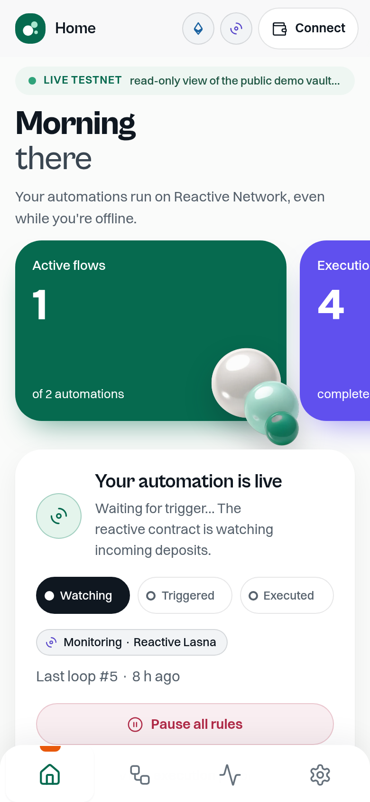 | 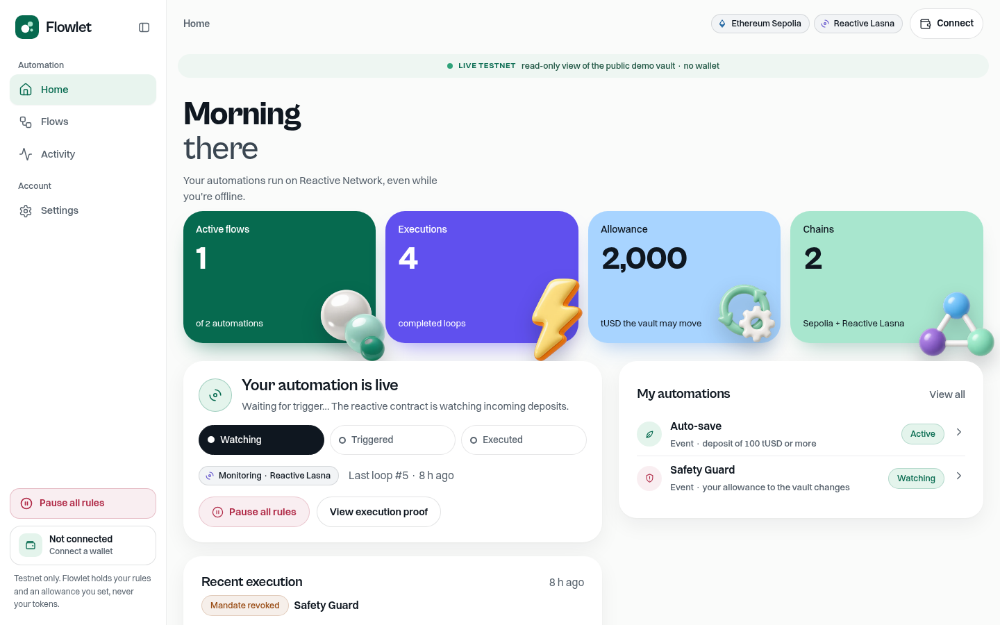 |

**Demo video (2:36):** [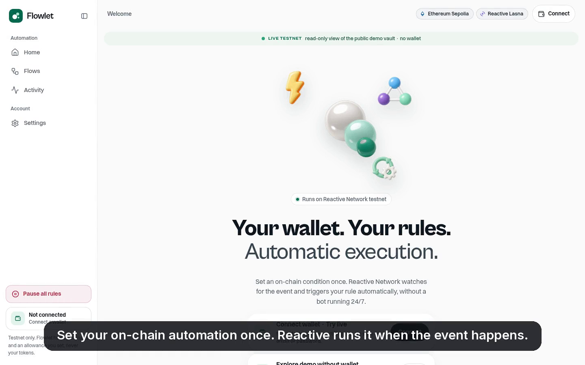](docs/video/flowlet-demo.mp4)

[docs/video/flowlet-demo.mp4](docs/video/flowlet-demo.mp4) (4.7 MB). English voiceover (edge-tts neural voice) and burned-in captions, recorded from the v3 live site in no-wallet, read-only mode. It shows the public vault in its current Active state. The Safety Guard revoke appears only as the recorded loop #5 proof; nothing was revoked on-chain for this recording.

Design system: [docs/DESIGN_NOTES.md](docs/DESIGN_NOTES.md) · Security, custody & privacy: [docs/SECURITY.md](docs/SECURITY.md) · Pitch: [docs/PITCH.md](docs/PITCH.md)

## How it works

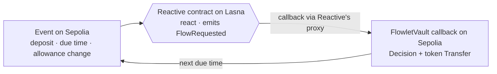

Every loop leaves three transactions you can open: the **origin** on Sepolia, the **reactive transaction** on Lasna, and the **callback** on Sepolia, sent by Reactive's callback proxy, not by your wallet or this page.

## Three ways in

| Path | What happens | Mode badge |
|---|---|---|
| **Connect wallet · Try live** | MetaMask on Ethereum Sepolia. The vault owner can run the demo loop live; any other wallet gets a read-only view and the replay. | `LIVE TESTNET` (warns on the wrong network) |
| **Explore demo without wallet** | Replays the recorded Sepolia + Lasna run step by step. Every link is a real transaction; nothing is sent. | `DEMO MODE` |
| **Watch the 2-minute walkthrough** | The in-app link opens the recorded demo video ([docs/video/flowlet-demo.mp4](docs/video/flowlet-demo.mp4)). The written [60-second demo](#60-second-demo) is below. | |

The local rehearsal (`?net=local`, two Anvil chains plus a stand-in relayer) is labelled `LOCAL REHEARSAL · private test chains on this computer · not real data`.

**Current state of the public demo vault (Nov 19, 2026):** active again. After loop #5 (the Safety Guard revoke), the owner re-approved a 2,000 tUSD allowance ([0x378e3ba6…](https://sepolia.etherscan.io/tx/0x378e3ba6ded52db445ec0c5833e913c021cd5257449abeb3e6abaf8f4e1b703e)) and called `resume()` ([0x68c15db6…](https://sepolia.etherscan.io/tx/0x68c15db6068afed32b537978919c0413f75a5b37a701395d7dd1ab74acbd3d8b)). The reactive contract on Lasna mirrored it: `paused=false`, watching deposits again. The live Home shows "Your automation is live", with Auto-save active and the Safety Guard watching. The standing order from the demo finished its 3 runs, so no CRON is subscribed right now. All of this is testnet only, with test tokens.

## 60-second demo

1. **0:00 · Open** [flowlet-kappa.vercel.app](https://flowlet-kappa.vercel.app). The welcome screen shows Event → Reactive → Action. Choose **Explore demo without wallet**.
2. **0:10 · Home is a control center:** a greeting, colour cards (active flows, executions, allowance, chains), the automation state (Watching → Triggered → Executed), My automations and the last execution.
3. **0:15 · Replay recorded loop** (the "Run demo loop" card; without the owner wallet it replays) walks five steps: Fund & allow → Set your rules → Reactive subscribes → Salary event → Reactive executes. The last step lists the three transactions of a real loop.
4. **0:35 · View execution proof:** origin, Lasna and callback links, plus the contract state before → after (runs, next due time, balances, or vault running → paused).
5. **0:50 · Pause vs revoke:** pausing stops every rule and Reactive drops its subscriptions, but the allowance stays. Revoking (allowance 0) makes Reactive pause itself and the vault. Loop #5 in the table below is that revoke; the vault was resumed afterwards.

## Installable on phones (PWA)

Flowlet looks and feels like a native app on a phone, without an APK. Open https://flowlet-kappa.vercel.app on your phone and **Add to Home Screen** (iOS: Share → Add to Home Screen; Android: the install prompt or ⋮ → Install app). It opens full screen with a bottom tab bar (Home · Flows · Activity · Settings) and a live **automation status card**: "Your automation is live · Waiting for trigger…", then Triggered and Executed as real reactive loops land. Desktop gets a sidebar (collapsible to an icon rail) and a two-column Home dashboard; tablet gets an icon rail.

- **Wallet on a phone:** Connect offers **Open in MetaMask**. **Replay the last real loop** needs no wallet and links every real transaction.
- **Offline:** the shell loads offline; automation state is never cached.
- **Fonts:** Cabinet Grotesk + Switzer from Fontshare (self-hosted, not committed per their license) and Geist Mono. Fetch them once with `bash scripts/fetch-fonts.sh web/fonts cabinet-grotesk@500 cabinet-grotesk@700 cabinet-grotesk@800 switzer@400 switzer@500 switzer@600`.

**v3 design (Nov 2026):**
- **Look:** a big two-line greeting and bold colour cards (brand green, violet, sky, mint), each with a glossy 3D object. There is also a Shortcuts bento, pill filter chips, and a white tab bar with a small active indicator.
- **Onboarding:** floating 3D objects and a black pill **Connect**.
- **Structure:** four tabs (Home · Flows · Activity · Settings), a Basic view with an Advanced section for contracts, chains and hashes, and a guided Create flow.
- **Coming soon:** unsupported triggers (price and whale alerts) are marked "Coming soon" and cannot be activated.
- **Accessibility:** axe-core reports 0 WCAG A/AA violations on the live site at 390, 820 and 1440 px.
- **Design notes:** see [docs/DESIGN_NOTES.md](docs/DESIGN_NOTES.md). The 3D objects are generated renders made for this project ([docs/brand/3d](docs/brand/3d/README.md)).

| Phone | Phone | Phone | Phone |
|---|---|---|---|
|  Home (live testnet, read-only, vault active) | 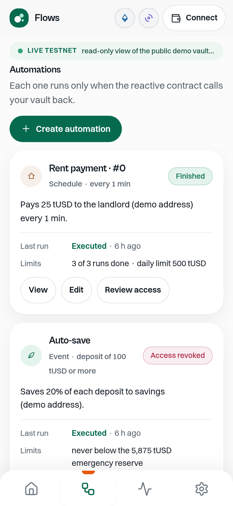 Flows: View / Create / Edit / Pause | 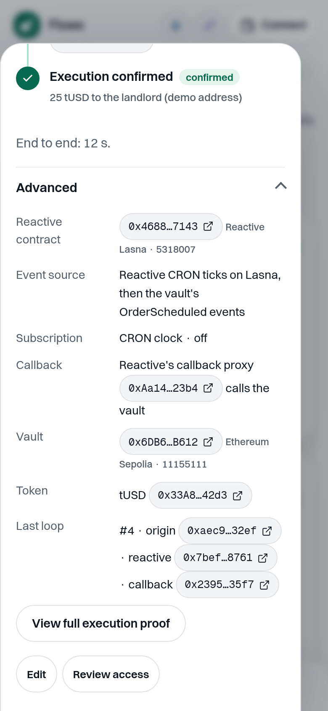 Automation detail with Advanced | 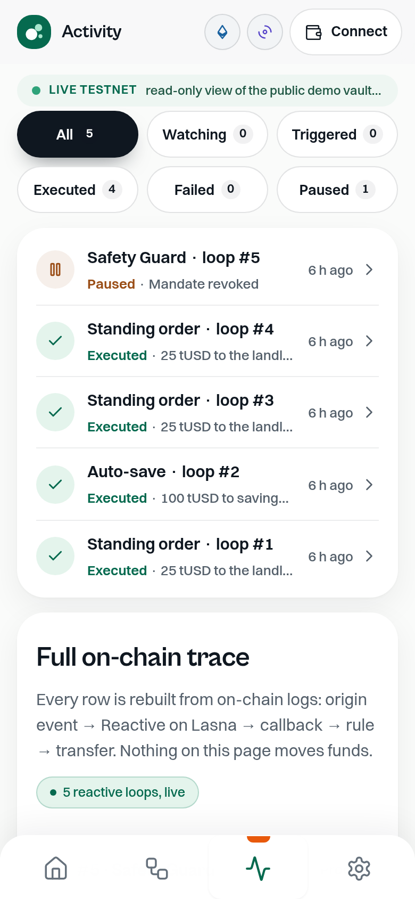 Activity filters |
| 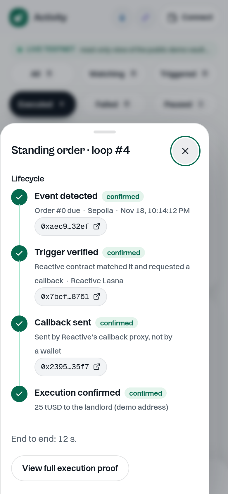 Event detected → Trigger verified → Callback sent → Execution confirmed | 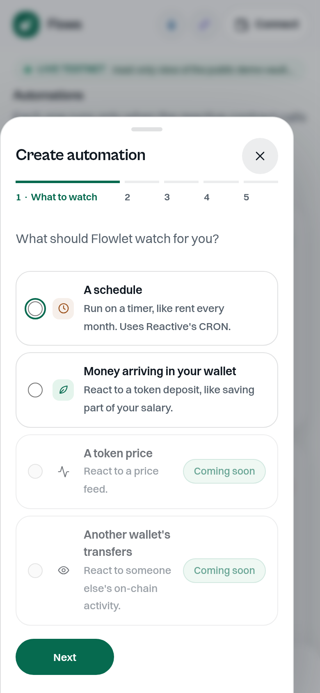 Guided Create | 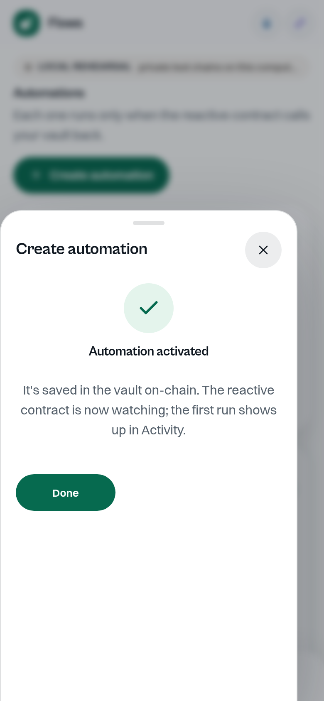 Activated (local rehearsal) | 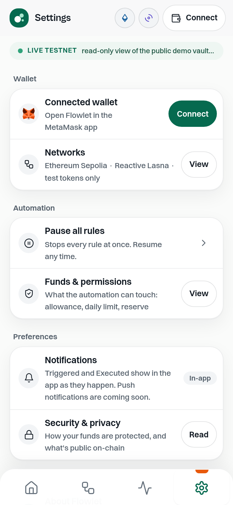 Settings: Wallet / Automation / Preferences / About |

| Desktop | Desktop | Tablet |
|---|---|---|
| 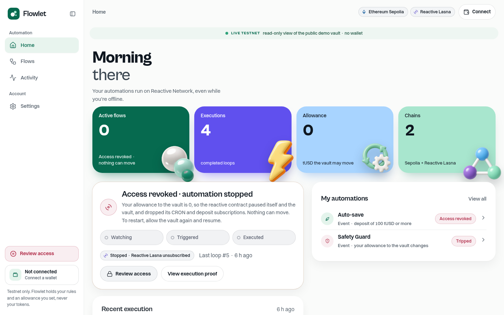 Home | 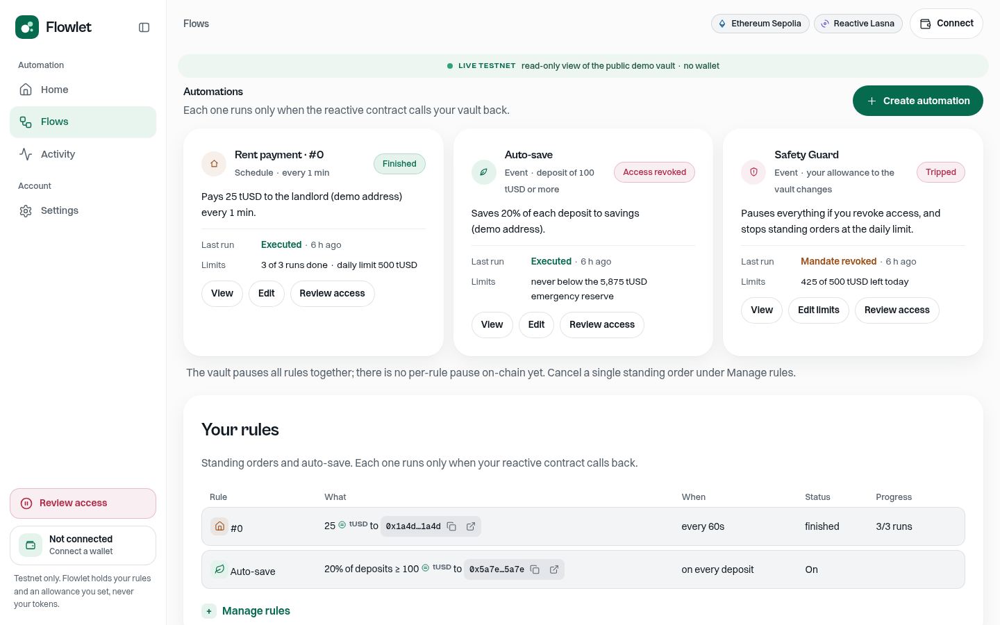 Flows | 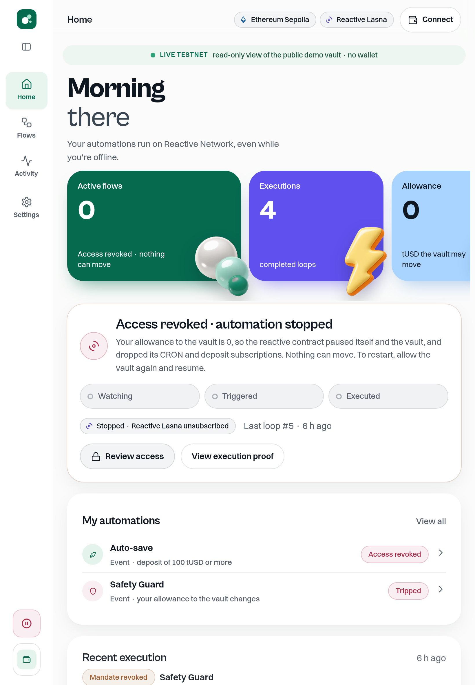 |

Icon: 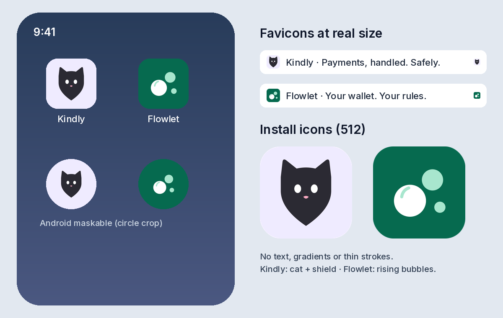

## What it does

| Rule | Trigger (watched by the reactive contract) | What happens on the destination chain |
|---|---|---|
| **Standing order**: "pay 25 tUSD to my landlord every 60 s / week / month, N times" | Reactive CRON, subscribed only while an order is active | `executeDue()` pays exactly the scheduled amount |
| **Auto-save**: "when I receive ≥ 100 tUSD, move 20% to savings" | `Transfer(to = my wallet)`, subscribed only while auto-save is on | `sweep()` moves the share to savings within seconds |
| **Safety Guard**: daily payment limit, emergency reserve, revoke = stop | `Approval(me → vault)` plus the vault's own guard events | Revoking the allowance makes the reactive contract pause itself (drops CRON and deposit subscriptions) and the vault. Hitting the daily limit trips the same breaker. |

**Rules interact.** The emergency reserve overrides the auto-save percentage. If saving 20% would push the wallet
below the reserve, Flowlet saves only what keeps the reserve intact, and the timeline explains why
("Auto-save wanted 200 tUSD … saved 125 tUSD so the wallet stays above its reserve").

## Live Reactive Proof (execution trace)

The dashboard rebuilds every automation from on-chain logs only, so judges can see that **Reactive callbacks, not
frontend buttons, moved the funds**:

1. **Origin event** on the destination chain (Ethereum Sepolia) (deposit, allowance change, or the tx that set an order's due time)
2. **Reactive transaction on Lasna**: `FlowRequested(nonce, kind, originTxHash)`
3. **Callback transaction** on the destination chain, checked to be sent **through Reactive's callback proxy** and not by the user
4. **Rule evaluation**: `Decision(nonce, …)`, emitted by the vault with the same `nonce`
5. **Action**: the token `Transfer` inside the callback transaction

…with explorer links and latency for each leg (origin → Lasna → callback). `scripts/report.mjs` produces the same
trace as a Markdown table for the DoraHacks submission.

## Architecture

```
 Ethereum Sepolia (or Base Sepolia)                        Reactive Lasna (5318007)
┌────────────────────────────────────────┐   events      ┌───────────────────────────────────────────┐
│ FlowletVault  (callback contract)      │ ────────────▶ │ FlowletReactive                           │
│  createOrder / configureSweep /        │ OrderScheduled│  • mirrors every rule (no setup on Lasna)  │
│  configureGuard / pause / resume       │ OrderExecuted │  • CRON on only while ≥1 order & not paused│
│  executeDue(rvm, nonce, ids[])  ◀───┐  │ SweepConfigured│ • deposit watch on only while auto-save on│
│  sweep(rvm, nonce, amount, tx, idx) │  │ GuardTripped… │  • circuit breaker on Approval(→ 0)       │
│  tripGuard(rvm, nonce, reason)      │  │               │  • batches due orders, de-dups in-flight  │
│  emits Decision(nonce, …)           │  │               │  • emits FlowRequested(nonce, …)          │
└─────────────────────────────────────┼──┘               └───────────────────────────────────────────┘
 tUSD ── Transfer(→ wallet), Approval ┼────────────────▶            requestCallbackV_1_0(...)
                                      └──── Reactive callback proxy ◀──────────────┘
```

Why the reactive contract does real work (the "Integration" criterion):

* **Self-configuring.** Users only talk to the vault; the reactive contract learns every rule from the vault's events.
* **Dynamic subscriptions.** It subscribes and unsubscribes at runtime, from inside `react()`: CRON, deposits, and back.
  An idle or paused Flowlet costs nothing.
* **Circuit breaker on Reactive.** A revoked mandate is detected and enforced on Reactive first (no more callbacks
  are even requested), then mirrored to the vault.
* **Batching and de-duplication.** All due orders go out in one callback; `pendingSince` prevents duplicate requests.

Safety on the destination:

* Every callback is guarded by `onlyServiceProvider` (callback proxy) **and** `onlyCallbackSender` (this reactive contract).
* The vault re-validates everything (due time, pause state, daily limit, reserve, duplicate origin logs), so a stale or
  repeated callback is a no-op that still logs a `Decision`.
* Non-custodial: one capped ERC-20 allowance. Paying yourself or saving into your own wallet is rejected (no loops).
* No catch-up bursts after downtime; failed pulls retry after 2 min and auto-close after 3 consecutive failures.
* All timers use `block.timestamp`, never block counts (Base Sepolia has 200 ms blocks).

## Repository layout

| Path | What |
|---|---|
| `src/FlowletReactive.sol` | Reactive contract on Lasna |
| `src/FlowletVault.sol` | Callback contract on the destination chain (rules, Safety Guard, `Decision` trace events) |
| `src/MockUSD.sol` | Testnet stablecoin (tUSD) with an open faucet |
| `test/Flowlet.t.sol` | 21 Foundry tests: full-loop simulation, circuit breaker, daily limit, reserve override, security, fuzzing |
| `web/` | Dashboard (`index.html`, `app.js`, `style.css`), the app shell (`shell.js`, `app-shell.css`, `sw.js`, `manifest.webmanifest`, `icons/`, `fonts/`) and the shared trace builder `trace.js` |
| `scripts/deploy.sh` | Deploys and wires everything, writes `deployments/<net>.json` |
| `scripts/demo.sh` | The Run demo story from the command line |
| `scripts/report.mjs` | Full-loop evidence table (Markdown) from RPC data only |
| `scripts/flowlet.sh` | CLI: status, order, cancel, save, guard, pause, resume, revoke, mint, cron fast/slow |
| `scripts/local-stack.sh` | Two local anvil chains plus a relayer that plays Reactive Network, plus the dashboard |
| `scripts/local-e2e.sh` | Headless rehearsal of the full story with pass/fail checks |

## Quick start (local, no testnet funds needed)

```bash
git clone --recursive https://github.com/yunnaysy/flowlet.git && cd flowlet
forge test                          # 24 tests
bash scripts/fetch-fonts.sh web/fonts cabinet-grotesk@500 cabinet-grotesk@700 cabinet-grotesk@800 switzer@400 switzer@500 switzer@600   # Fontshare fonts, not committed (license)
scripts/local-stack.sh              # then open http://localhost:8000/web/?net=local and press Run demo loop
scripts/local-e2e.sh                # or: the same story headless, ~3 minutes, prints LOCAL E2E: OK
```

The local relayer only stands in for Reactive Network so the UI can be developed offline. The real submission
evidence comes from Ethereum Sepolia + Lasna (below).

## Deploy to testnet (Ethereum Sepolia + Reactive Lasna; Base Sepolia optional)

1. Put a **fresh, testnet-only** key in `DEPLOYER_SECRET.txt` (`PRIVATE_KEY=0x…`; the file is git-ignored).
2. Fund that address with ~0.05 Sepolia ETH. `deploy.sh` checks the budget, then buys ~3 lREACT itself by sending
   0.03 ETH to the Lasna faucet contract (`request(address)`, 1 ETH → 100 lREACT), and keeps 0.005 ETH in the vault
   to pay for callbacks.
3. Run:

```bash
scripts/deploy.sh                          # MockUSD + FlowletVault (Sepolia), FlowletReactive (Lasna)
python3 -m http.server 8000                # dashboard: http://localhost:8000/web/  (defaults to eth-sepolia)
scripts/demo.sh                            # or press Run demo with the deployer account in MetaMask
node scripts/report.mjs                    # writes deployments/eth-sepolia.LOOP_REPORT.md
scripts/flowlet.sh cron slow               # after recording: Cron100 to save lREACT
```

Other destinations: `NETWORK=base-sepolia scripts/deploy.sh` (faucet contract on Base Sepolia too) or
`NETWORK=unichain-sepolia` (fund lREACT on Lasna separately). Then open the dashboard with `?net=<network>`.

## Network reference (testnet)

| | Value |
|---|---|
| Reactive Lasna | RPC `https://lasna-rpc.rnk.dev/`, chain id `5318007`, explorer `https://lasna.reactscan.net` |
| System contract | `0x8888888888888888888888888888888888888888` |
| CRON source | `0x0000000000000000000000000000000000fffFfF` (Cron10 ≈ 10 s, Cron100 ≈ 100 s) |
| Ethereum Sepolia callback proxy | `0xAa14d9Cd0f788Ca23d11805986C1d8bd035D23b4` |
| Base Sepolia callback proxy | `0x476F44b11F5C942c58f4c8E3d0300E5710743585` |
| Unichain Sepolia callback proxy | `0x775c9B990ADe401060B78D0e98684eEf8d2466C1` |
| lREACT faucet contracts | Base Sepolia `0x2afaFD298b23b62760711756088F75B7409f5967`, Ethereum Sepolia `0x9b9BB25f1A81078C544C829c5EB7822d747Cf434` |

Library: [`reactive-lib-omni`](https://github.com/Reactive-Network/reactive-lib-omni) v0.1.0 (`requestCallbackV_1_0`).

## Deployed contracts and full-loop transactions

Live on **Ethereum Sepolia** (destination, chain 11155111) + **Reactive Lasna** (chain 5318007), deployed 18 Nov 2026.

| Contract | Chain | Address | Deploy tx |
|---|---|---|---|
| FlowletReactive | Lasna | [`0x468866a09EA93935aEAb65B3f8b1db8c1dF57143`](https://lasna.reactscan.net/address/0x468866a09EA93935aEAb65B3f8b1db8c1dF57143) | [0x015ec571…](https://lasna.reactscan.net/tx/0x015ec5712ad13152ab6e64e25d27bd64e63f6ba611f3cdfd28b225404c41bb19) |
| FlowletVault | Ethereum Sepolia | [`0x6DB68e4AbF7c6F276Af36B231Ec30f8ce8e1B612`](https://sepolia.etherscan.io/address/0x6DB68e4AbF7c6F276Af36B231Ec30f8ce8e1B612) | [0x77dde0a1…](https://sepolia.etherscan.io/tx/0x77dde0a18d9fe007e41a77cea8574bd37c277060d1dd297bc0709beb6f2f0f71) |
| MockUSD (tUSD) | Ethereum Sepolia | [`0x33A8adf307B1D66825e5a76D388F82aD015042d3`](https://sepolia.etherscan.io/address/0x33A8adf307B1D66825e5a76D388F82aD015042d3) | [0xebd73f72…](https://sepolia.etherscan.io/tx/0xebd73f72b86ac370f9511fe03c36f38dcba9af924c25cd009d4455ea1bc60f1f) |

Wiring: `setVault` [0xe5b9b0d6…](https://lasna.reactscan.net/tx/0xe5b9b0d6537f150c323ed733b8b4a912704c4077c52f00e054e1dcadb9d4749a) · callback proxy `0xAa14d9Cd0f788Ca23d11805986C1d8bd035D23b4` · every callback below
was sent by the Reactive signer `0xF7E866D726658F6C3F14B8EE537fe268a4D91DDb` to that proxy, not by the vault owner.

Full loops from the demo run (`scripts/demo.sh`, then `node scripts/report.mjs`):

| Nonce | Rule | Origin (eth-sepolia) | Reactive tx (Lasna) | Callback tx (eth-sepolia) | Via callback proxy | Decision | Moved | origin→Lasna | origin→callback |
|---|---|---|---|---|---|---|---|---|---|
| 1 | Standing order | Order #0 due [0xadb2033d…](https://sepolia.etherscan.io/tx/0xadb2033d02077fb1a678e8c720277cd26c6cdf3f6fdd56f40e771d5b8da9e6fb) | [0x384be8c1…](https://lasna.reactscan.net/tx/0x384be8c181648137c8dd9802e5dcda774d9e18854eade7a2ed72320d9beaa568) | [0xbb963e36…](https://sepolia.etherscan.io/tx/0xbb963e3664dd62ece8b31ef37b9dd4b2bdf1c5ea16d4274e5049b302ea22afc7) | yes | Executed | 25 | 10s | 24s |
| 2 | Auto-save | Deposit of 1,000 tUSD [0x765ab31a…](https://sepolia.etherscan.io/tx/0x765ab31a952aa34bbfbca6e53cccee2793178be98bd7933c7cba1a34c4844bcb) | [0x1124cd20…](https://lasna.reactscan.net/tx/0x1124cd205e36b9bf7052c5bdf1af0870964462a2edcd207cc78f7e778d6fbf3f) | [0x9c498032…](https://sepolia.etherscan.io/tx/0x9c498032896cfe348df69b275b9b7a3be39df5356644f723635d5b3da4da3cda) | yes | Reserve override | 100 | 0s | 12s |
| 3 | Standing order | Order #0 due [0xbb963e36…](https://sepolia.etherscan.io/tx/0xbb963e3664dd62ece8b31ef37b9dd4b2bdf1c5ea16d4274e5049b302ea22afc7) | [0xdc3ff283…](https://lasna.reactscan.net/tx/0xdc3ff2834a0c68c1fb1fdc4ce8c26f2c5821c70a3bd0b14d6761e6bfc10ee79a) | [0xaec91c40…](https://sepolia.etherscan.io/tx/0xaec91c403e66a10d7b68dbffccbab92066476aa10ad11d9de69ec8b195cd32ef) | yes | Executed | 25 | 2s | 12s |
| 4 | Standing order | Order #0 due [0xaec91c40…](https://sepolia.etherscan.io/tx/0xaec91c403e66a10d7b68dbffccbab92066476aa10ad11d9de69ec8b195cd32ef) | [0x7bef8106…](https://lasna.reactscan.net/tx/0x7bef81063482c04ac98dac19a30ab2c035a1f2a3d8837410dd6b3baaa1f18761) | [0x2395d899…](https://sepolia.etherscan.io/tx/0x2395d899e8ee6688b0837f614235412475671fdaeebd1f68dbedbd09c58635f7) | yes | Executed | 25 | 6s | 12s |
| 5 | Safety Guard | Allowance set to 0 [0x73b15853…](https://sepolia.etherscan.io/tx/0x73b1585314bb627bdca44fa5d91154894cdcbea9243cb61105bb2a70a09ec197) | [0x80f5a6e1…](https://lasna.reactscan.net/tx/0x80f5a6e14014b0db204c059998aacd6ae883391768e0d0309b4b27d34f38faf3) | [0x4e543009…](https://sepolia.etherscan.io/tx/0x4e5430092a2fd0f18e3d13c9d913646a6fb68b8dadf80fcae38ccda6df37d011) | yes | Mandate revoked | 0 | 1s | 24s |

- **#1 Standing order:** Paid 25 tUSD to 0x1a4d…1a4d (order #0).
- **#2 Auto-save:** Auto-save wanted 200 tUSD of the 1,000 tUSD deposit, but the emergency reserve rule overrides it: saved 100 tUSD so the wallet stays above its reserve.
- **#3 Standing order:** Paid 25 tUSD to 0x1a4d…1a4d (order #0).
- **#4 Standing order:** Paid 25 tUSD to 0x1a4d…1a4d (order #0).
- **#5 Safety Guard:** The allowance was revoked. Reactive paused itself, dropped its CRON and deposit subscriptions, and paused the vault.

Full report: [`deployments/eth-sepolia.LOOP_REPORT.md`](deployments/eth-sepolia.LOOP_REPORT.md).

## Limitations and next steps

* One stablecoin and one vault per user, which keeps authorization simple. A factory could deploy vault + reactive pairs.
* Up to 32 active orders per Flowlet and 8 per callback batch.
* The daily limit applies to standing-order payments; auto-save only moves money to the user's own savings address.
* Next: calendar-month schedules, multiple tokens, Unichain + Base in one Flowlet.

## License

MIT
